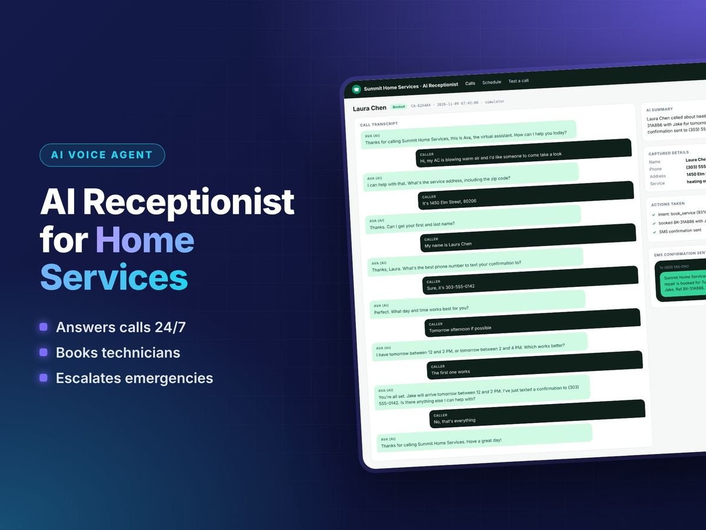
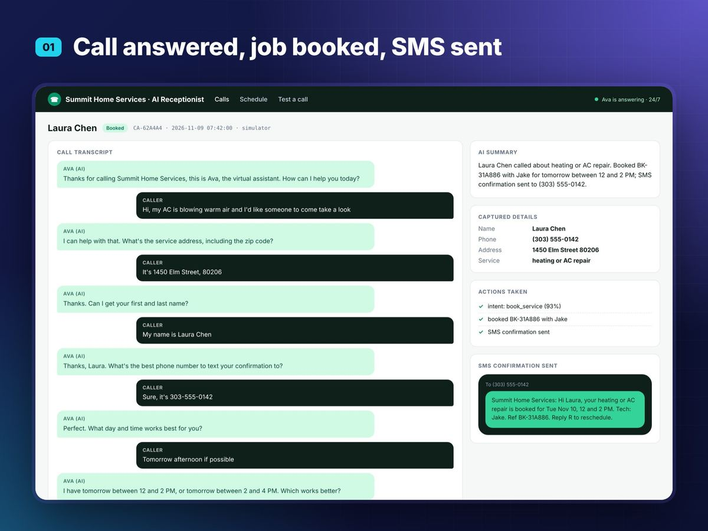
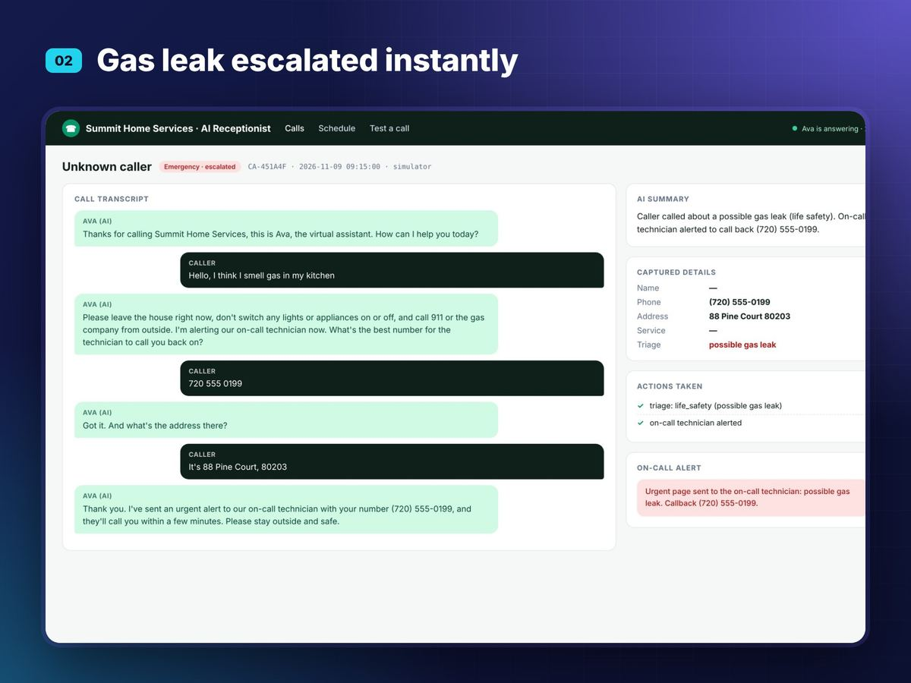
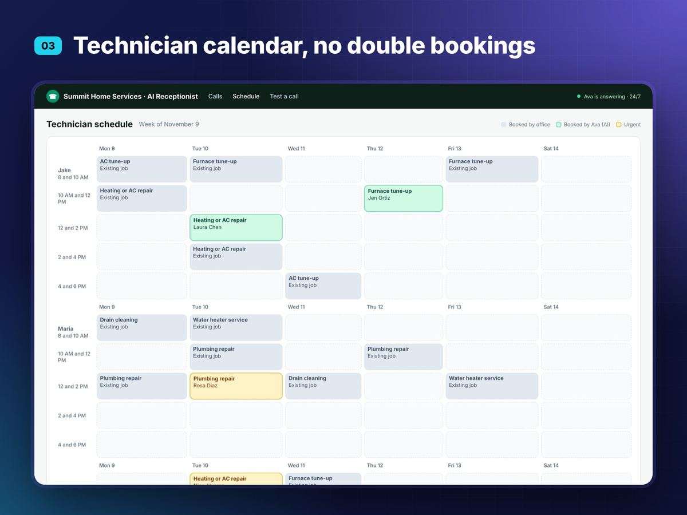
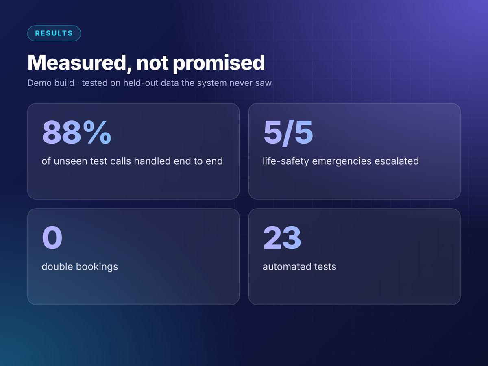

# AI Voice Receptionist for Home Services

<p align="center"></p>

> Part of **[Afnan Asjad's AI portfolio](https://afnan309.github.io)** · [Hire me on Upwork](https://www.upwork.com/freelancers/~012b76801e57487390)

"Ava" answers calls for a home-services company (HVAC, plumbing, electrical): safety triage, booking into a
technician calendar, SMS confirmations, pricing and hours questions, transfers, and a call log with summaries.

**Phone layer:** Vapi (speech-to-text, LLM, text-to-speech) calls this backend through tool calls.
**Backend:** owns every business decision, so prices, availability and safety rules never come from the LLM's memory.

## Structure
```
receptionist/
  triage.py     rule-based safety triage (life_safety / urgent)
  nlu.py        intent classifier + extractors (service, day, time, name, phone, address)
  calendar.py   2-hour windows, skill-based technician assignment, SQLite bookings
  tools.py      business tools shared by Vapi and the simulator
  dialog.py     dialog manager used by the simulator and evaluation
  vapi.py       Vapi server-message handler (tool-calls, end-of-call-report)
  store.py      call log
vapi/assistant.json   Vapi assistant config: system prompt + 7 tools
web/app.py            dashboard, schedule, browser simulator, POST /vapi/webhook
```

## Run
```bash
pip install -r requirements.txt
python scripts/seed_demo.py      # reset demo data and replay a day of sample calls
python web/app.py                # http://localhost:8300
pytest tests -q                  # 23 tests
python eval/run_eval.py test     # held-out scripted calls
```

## Connect to Vapi
1. Deploy `web/app.py` on a public HTTPS URL (Render, Railway, a VPS, or ngrok for testing).
2. In Vapi, create an assistant from `vapi/assistant.json`; set `server.url` to `https://YOUR-DOMAIN/vapi/webhook`
   and choose a voice.
3. Buy or import a phone number in Vapi and attach the assistant.
The payload handling follows Vapi's server-message format (`message.type` = `tool-calls` / `end-of-call-report`).
Check field names against the current Vapi docs when you connect; it has only been tested with simulated payloads.

## Results (scripted calls, logic only; excludes speech recognition and the LLM)
| Set | Result |
|---|---|
| Dev set, first run (unseen at the time) | 24/30. Exposed 6 bugs, all fixed (30/30 after) |
| Fresh test set, run once | **22/25 (88%)** · life-safety 2/2 · urgent 3/4 · 0 double bookings |

Known issues from the test run:
1. "Not right now, thanks" after a price answer isn't read as "no".
2. "The heat won't come on" isn't flagged urgent.
3. If only one window is offered and the caller says "second", Ava re-asks instead of recovering.

## Customise
Edit `data/business.json` (name, hours, zip codes, technicians and skills, prices) and the safety rules in
`receptionist/triage.py`.

## Screenshots

| | |
|---|---|
|  |  |
|  |  |
